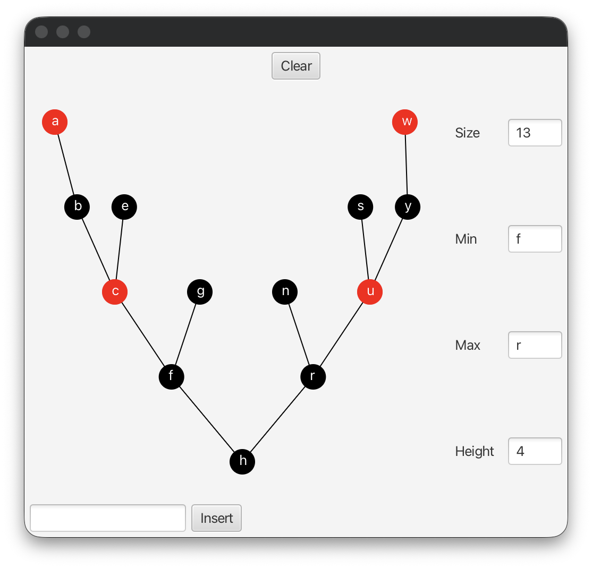

# Overview

In this lab, we will implement rotations for Binary Search Trees and use them to implement the insertion
operation for Red-Black Trees.

## Materials 

* IntelliJ
* Lab Partner

## Setup

1.  Download the [skeleton](../code/red_black_lab.zip) for this project.
2.  Unpack the code into a new IntelliJ Java project.

# Description

A Red Black Tree is a peculiar data structure, crossing the bridge color theory and data structures. What is really special about it is how compact it ensures the tree is. To do this, it has to meet certain criteria, and follow an algorithm to ensure it stays in a certain form.

## Step 0: Introduction

{: .img-fluid}

When opening the project, you will see `core` and `gui`. You will only need to write code in core. You will need to only **write** code in one class: `RBNode`. Open this file, and scroll down until you see **TODO**.

Each node has a left, right, parent, and a color. You can get and set these at your will.

We will start by writing some helper functions to introduce you to the elements needed for this lab.

### Step 0.1: `getGrandParent()`

We will need to reference the parent of the parent of a node, the grandparent. Write a function that returns a reference to the grandparent of a node.

### Step 0.2: `getPibling()`

We also need to refer to the pibling of a node (the sibling of the parent). Write a function that returns a reference to the pibling of a node.

First get a reference to the grandparent, and then ask `whichChild` the parent is of the grandparent. The returned `Child` enum will be either `LEFT` or `RIGHT`, and the pibling is on the opposite side.

## Step 1: `redRedViolation()`

Now you will write the rest of your code.

This is one of the first invariants of a Red Black Tree. It states that "A red node cannot have a red child." To prevent this from happening, write a check to alert if this invariant in violated, where a red node also has a red child.



To complete this step, the `RBTest.testRedRedViolation()` test should pass.

## Step 2: `leftRotate()` and `rightRotate()`

To prevent the tree from becoming too tall on one side, we must be able to rotate them to move X to the right or to the left. We can do this relatively fast, in just one method.



To complete this step, you must pass the `testRightRotate()` and `testLeftRotate()` in `RBTest`.

## Step 3: `redPiblingFixup()`

This function is not used yet, as you will use it in Step 5. Essentially, if X's pibling's color is red, we must do various actions to clean up. You must color X's parent and pibling to black, and call `insertFixup` on X's grandparent.

To complete this step, you must pass the `testRedPiblingFixup` test in `RBTest`

## Step 4: `blackPiblingFixup()`, `zigs` and `zags`

This is the bulk of the logic for maintaining the invariants of the Red Black Tree. Essentially dependening on what type of child X is, and which type of child X's parent is, we do different actions. To determine what type of child X is, you may use the `whichChild(X)` and use an `if` statement to determine what to do in each situation.

### Step 4.1: `zigZig()`

Zig Zig is the case where X is a left child and X's parent is a left child. When this happens, you must color X's parent black and rotate X's grandparent to the right.

To complete this step, you must pass the `zigZigInvariant()` test.

### Step 4.2: `zigZag()`

Zig Zag is the case where X is a left child and X's parent is a right child. When this happens, you must color X black, rotate X's parent to the right and rotate X's grandparent to the left.

To complete this step, you must pass the `zigZagInvariant()` test.

### Step 4.3: `zagZig()`

Zag Zig is the case where X is a right child, and X's parent is a left child. When this happens, you must color X black, rotate X's parent to the left and rotate X's grandparent to the right.

To complete this step, you must pass the `zagZigInvariant()` test.

### Step 4.4: `zagZag()`

Zag Zag is the case where X is a right child, and X's parent is a right child. When this happens, you must color X's parent black and rotate X's grandparent to the left. 

To complete this step, you must pass the `zagZagInvariant()` test.

### Step 4.5: `blackPiblingFixup()`

Finally, using all of the zig and zag functions, determine the cases mentioned above on what function to use. For example, if X is a left child, and X's parent is a left child, you would need to call `zigZig`.

## Step 5: `insertFixup()`

Whenever an item is insert, it is important to see if it needs to be moved around. We do this through the `insertFixup()` function. It is called every time an item is inserted into the tree, on that item. Follow the flow chart, and make sure to use your `redPiblingFixup()` and `blackPiblingFixup()` functions!



## Step 6: GUI Evaluation

Now that you have a working Red Black Tree passing all of the tests, use the GUI to sequentially add each letter in the alphabet, and watch the tree rebalance as necessary.